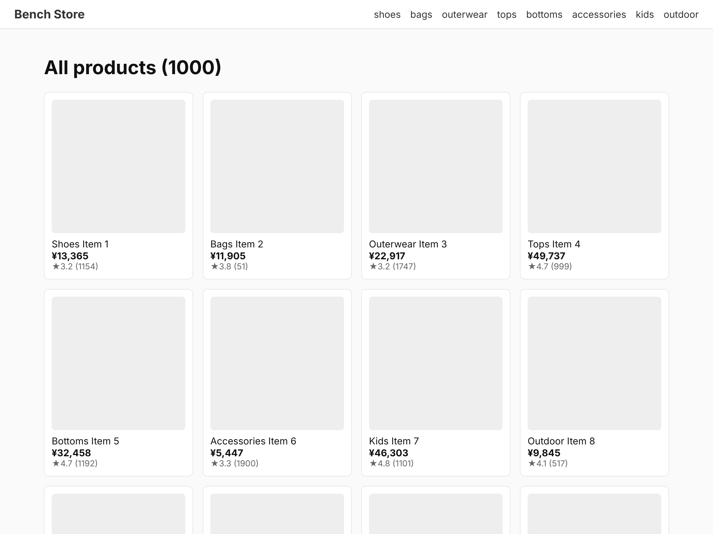
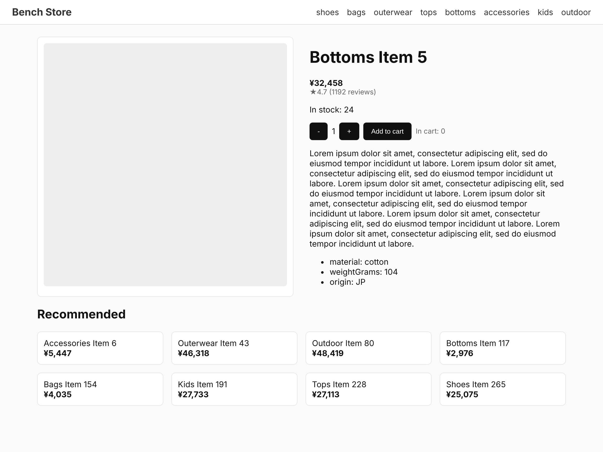
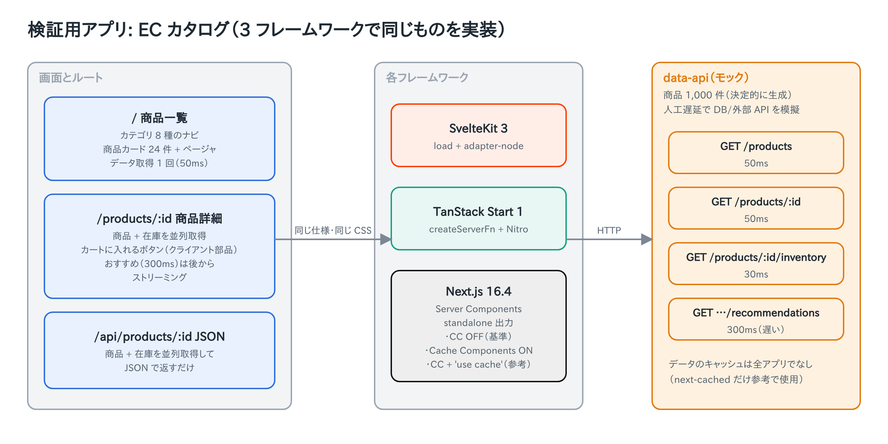
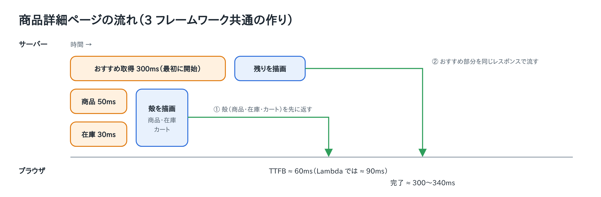
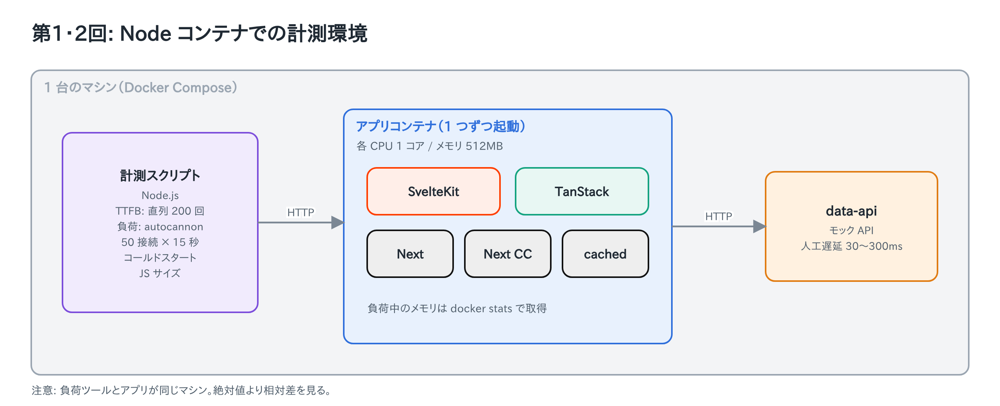
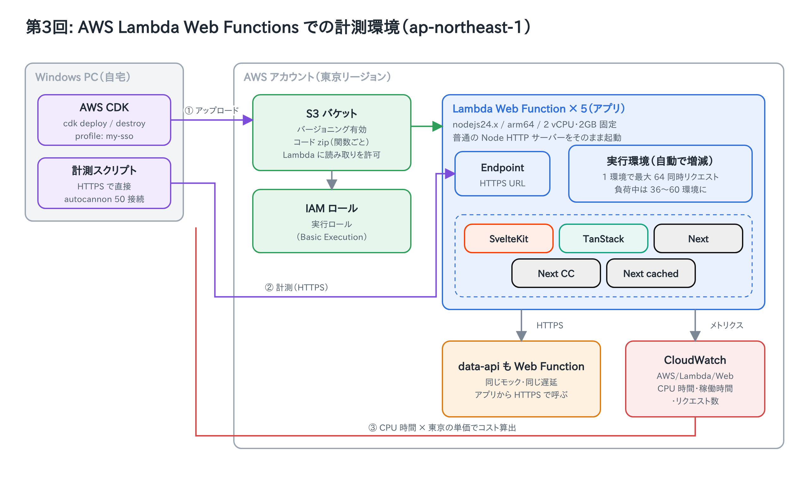
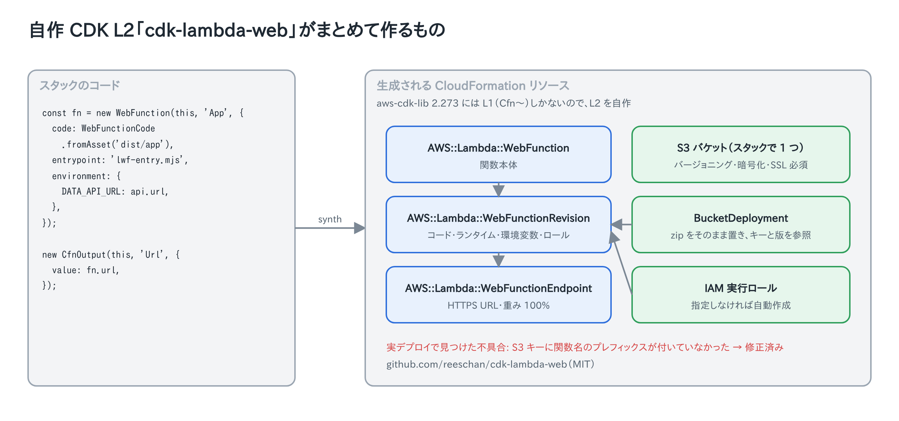

# reeschan-fw-bench-ec

SvelteKit 3 / TanStack Start 1.0 / Next.js 16.4 で同じ EC カタログアプリを作り、Node コンテナと AWS Lambda Web Functions で性能とコストを比べたときのコード一式です。

- 結果のまとめ: [RESULTS.md](RESULTS.md)
- アプリの仕様: [SPEC.md](SPEC.md)
- Lambda Web Functions で計測する手順: [LWF-RUN.md](LWF-RUN.md)
- Lambda Web Functions 用の CDK L2: [reeschan/cdk-lambda-web](https://github.com/reeschan/cdk-lambda-web)

## 画面

| 商品一覧 | 商品詳細 |
|---|---|
|  |  |

## アーキテクチャ

### アプリ

5 つのアプリは同じ仕様・同じ CSS で実装し、データはすべて共通のモック API（data-api）から取ります。



商品詳細ページは、遅いおすすめ API を最初に呼び出し、商品と在庫を並列で待って殻を先に返し、おすすめを後からストリーミングします。



### 計測環境：Node コンテナ



### 計測環境：AWS Lambda Web Functions



CDK の L2 は自作の [cdk-lambda-web](https://github.com/reeschan/cdk-lambda-web) を使っています。



## 構成

```
data-api/          共通のモック API（商品 1,000 件、人工遅延つき）
apps/sveltekit/    SvelteKit 3（adapter-node）
apps/tanstack/     TanStack Start 1.x（Vite + Nitro node-server）
apps/next/         Next.js 16.4（standalone、Cache Components OFF）
apps/next-cc/      Next.js 16.4（Cache Components ON、データキャッシュなし）
apps/next-cached/  Next.js 16.4（Cache Components ON + 'use cache'、参考値）
shared/styles.css  全アプリ共通の CSS
scripts/           ビルドと計測のスクリプト
docker-compose.yml Node コンテナ計測用（各アプリ cpus=1 / mem 512MB）
infra-lwf/         Lambda Web Functions へのデプロイ（AWS CDK）
results/           Node コンテナ計測の生データ
```

data-api の遅延（環境変数で変更可）: 一覧 50ms、商品 50ms、在庫 30ms、おすすめ 300ms。

## Node コンテナで計測する

```bash
./scripts/build-all.sh       # 各アプリを本番ビルドして実行用イメージを作る
cd scripts && npm ci && cd ..
node scripts/run-all.mjs     # --quick で短縮版。引数でアプリを絞れる（例: sveltekit next）
```

| スクリプト | 内容 |
|---|---|
| ttfb.mjs | 直列リクエストで TTFB と完了時間の p50/p95（各ルート 200 回、ウォームアップ 20 回） |
| load.mjs | autocannon 50 接続 × 15 秒。RPS、p50/p99、エラー数、負荷中のピークメモリ |
| jssize.mjs | ページが読み込むクライアント JS の合計（gzip）と HTML サイズ |
| coldstart.mjs | コンテナ起動から最初の 200 応答まで、再起動直後の 1 リクエスト目 |

## Lambda Web Functions で計測する

[LWF-RUN.md](LWF-RUN.md) を見てください。各フレームワークの Node サーバー出力に、`AWS_LAMBDA_HTTP_ENDPOINT` を `HOST` / `PORT` に詰め替える数行の入口ファイル（`lwf-entry.mjs`、`scripts/package-lwf.sh` が生成）を足すだけで動きます。

## 公平性のために揃えたこと

- データ取得はすべてサーバー側（TanStack は `createServerFn` 経由）。データのキャッシュはなし（next-cached を除く）。
- 商品と在庫は並列取得、おすすめ（300ms）は最初に開始してストリーミング。全アプリ同じ順序。
- 計測リクエストはブラウザの User-Agent を付ける。TanStack Start はボット判定の UA だとストリーミングしないため。

## 注意

- Node コンテナ計測では、負荷ツールとアプリが同じマシンで動きます。絶対値より相対差を見てください。
- autocannon は 50 接続が応答を待ってから次を送るので、RPS には「50 ÷ 応答時間」の上限があります。詳細ページ（約 300ms）は約 150〜160 RPS が上限です。
- Lambda Web Functions は 2026-10 時点の仕様で検証しています。

## ライセンス

MIT
