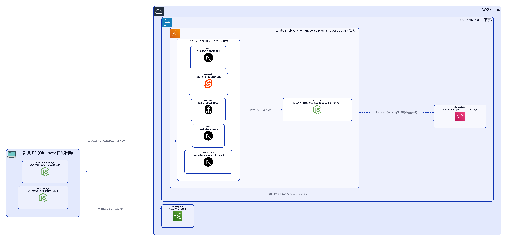
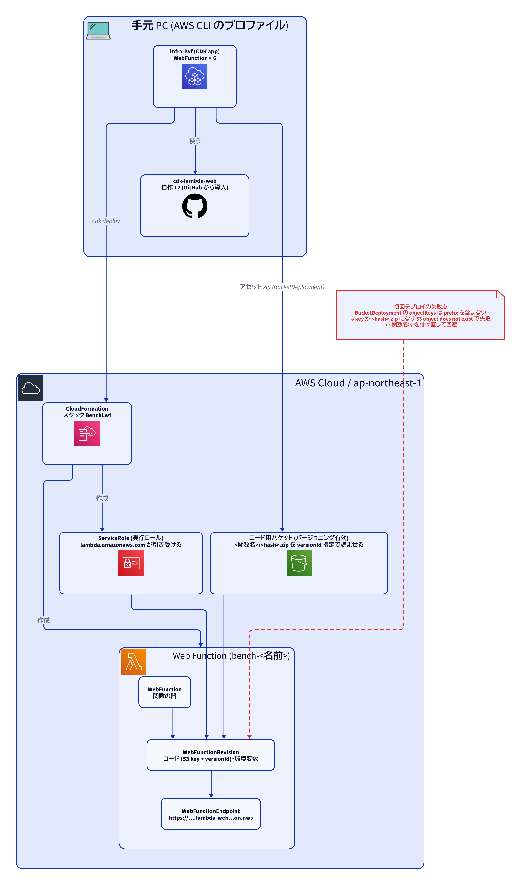
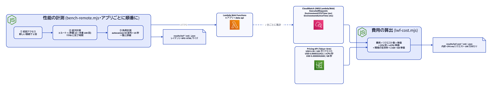

# Lambda Web Functions で比べたら、差は速さより費用に出た: SvelteKit 3 / TanStack Start / Next.js 16.4

2026-10-16 / 東京リージョン (ap-northeast-1)

コード一式 (アプリ・CDK・計測とコスト算出のスクリプト・結果): https://github.com/reeschan/reeschan-fw-bench-ec

## TL;DR

- **速さ**: 1 件ずつ順に測ったレイテンシは 3 フレームワークでほぼ同じ (詳細ページの完了 p50 は 340〜349ms。ほとんどが疑似 API の待ち時間)。差が出たのは **初回起動・一覧ページの負荷時の応答時間・CPU 使用量**。
- **費用**: **1 リクエストあたりの CPU 時間は SvelteKit 5.7ms・TanStack 7.7ms・Next.js 18.7〜27.5ms** (SvelteKit 比で 3.3〜4.8 倍、TanStack 比で 2.4〜3.6 倍)。トラフィックに比例する費用 (リクエスト料金 + CPU) は SvelteKit が 100 万リクエストあたり約 0.48 ドル、素の Next.js と next-cc が約 1.07〜1.19 ドルで、2 倍強の差。
- **動かし方**: 2026-10-12 に発表された Lambda の新機能 **Lambda Web Functions** に、同じ EC カタログ画面を 5 通り (SvelteKit 3 / TanStack Start / Next.js 16.4 の素・cacheComponents・キャッシュ有り) で載せた。どれも **アダプター無し** で、数行の入口ファイルを足すだけで普通の Node サーバーのまま動いた。
- ただし今回の費用の **約 9 割はメモリ** だった。Web Functions は環境 (2 vCPU / 2 GB) が生きている間ずっとメモリが課金され、負荷をかけると環境が 50〜60 個に増え、止めてからも 6 分以上残る。短いバースト負荷の費用は「何個の環境がどれだけ生きたか」でほぼ決まる。
- 計測全体の費用は約 0.96 ドル。
- **守り**: 本番では CloudFront を前に置き、エンドポイントを CloudFront からしか呼べないようにできる。WAF を付ければ IP 制限・レート制限・攻撃対策をアプリの外で持てる。
- 自作の CDK L2 (`cdk-lambda-web`) の初の実デプロイで、S3 key に prefix が付かない不具合を 1 件見つけて回避した。

## 目次

1. [この記事の用語](#この記事の用語)
2. [経緯](#経緯)
3. [Lambda Web Functions は従来の Lambda と何が違うか](#lambda-web-functions-は従来の-lambda-と何が違うか)
4. [登場するフレームワークの注目点](#登場するフレームワークの注目点)
5. [検証用アプリ「Bench Store」](#検証用アプリbench-store)
6. [検証環境と方法](#検証環境と方法)
7. [検証結果](#検証結果) (速さ・費用・自作 L2 で見つかったこと)
8. [Lambda Web Functions を選ぶ理由](#lambda-web-functions-を選ぶ理由) (費用・守り)
9. [考察とこれから](#考察とこれから)
10. [計測の注意点](#計測の注意点)

## この記事の用語

| 用語 | 意味 |
|---|---|
| p50 / p95 / p99 | 応答時間を速い順に並べたとき、50% / 95% / 99% の位置にある値。p50 は「ふつうの速さ」(中央値)、p99 は「100 回に 1 回くらい起きる遅さ」。p50 が速くても p99 が遅いと、たまに待たされる人がいる |
| TTFB | Time To First Byte。リクエストを送ってから、最初の 1 バイトが届くまでの時間。画面が描き始められるまでの目安 |
| 完了時間 | 応答の最後のバイトまで届くまでの時間。ストリーミングでは、TTFB で上半分が見え、完了時間で全部そろう |
| RPS | Requests Per Second。1 秒あたりに処理できたリクエストの数 |
| 逐次 / 負荷時 | 逐次は 1 件ずつ順に送ったとき。負荷時は 50 件を同時に送り続けたとき |
| 初回起動 (コールドスタート) | 動いているサーバーが 1 つも無い状態から、最初のリクエストに応えるまでの時間 |
| 環境 | Lambda がアプリを動かす小さなサーバー 1 台分 (2 vCPU / 2 GB)。アクセスが増えると自動で数が増え、しばらく使われないと消える |
| vCPU 秒 / GB 秒 | 課金の単位。CPU を 1 秒使うと 1 vCPU 秒、2 GB のメモリを 1 秒持つと 2 GB 秒 |
| 限界費用 | アクセスが増えたときに、それに比例して増える費用 (リクエスト料金 + CPU)。環境のメモリ代は含めない |
| SSR / ストリーミング | SSR はサーバーで HTML を作って返すこと。ストリーミングは、できた部分から先に送り、残りを後から流すこと |

## 経緯

- 新しく作る「AI 学習教材ジェネレーター」の構成を決める中で、SvelteKit 3 を Lambda Web Functions (東京・Node.js 24・arm64) に載せる方針にした。Web Functions は 2026-10-12 発表の新しい形態で、ポートで待ち受ける普通の HTTP サーバーを Lambda で動かせる。課金は「リクエスト数 + 使った CPU 時間 + 環境が持つメモリ」。
- 方針を決める前に、手元では SvelteKit / TanStack Start / Next.js を同じ画面で比べるベンチを作っていた。これを実際の Web Functions に載せて、
  1. 本当にアダプター無しで動くか
  2. フレームワークで速さと費用がどれだけ変わるか
  3. 自作の CDK L2 `cdk-lambda-web` で実際にデプロイできるか
  を確かめることにした。

## Lambda Web Functions は従来の Lambda と何が違うか

Web アプリは、これまでの Lambda (今は「Lambda Event Functions」と呼ばれる。[AWS のローンチブログ](https://aws.amazon.com/blogs/aws/announcing-aws-lambda-web-functions-for-fast-consistent-web-app-performance-anywhere/)) でも動かせた。Function URL や API Gateway の後ろに置き、Lambda Web Adapter や各フレームワークの Lambda 用アダプター (OpenNext など) で「HTTP リクエスト ⇔ Lambda のイベント」を変換する形だ。静的なページだけなら、S3 + CloudFront で配るのが今も定番。Web Functions で変わったのは、**SSR のような「動的に HTML を作るサーバー」の載せ方**。

| | Event Functions (従来の Lambda) | Web Functions |
|---|---|---|
| 書き方 | `handler(event, context)` を書く。Web アプリはアダプターで変換する | ポートで待ち受ける普通の HTTP サーバーをそのまま動かす。アダプター不要 |
| 1 環境の同時処理 | 1 リクエストずつ | 1 環境で最大 128 リクエストを同時に処理 (既定の上限は 64 とされる) |
| 課金 | 実行時間 × メモリ (I/O 待ちの時間も課金) | 使った CPU 時間 + 環境が生きている間のメモリ。DB や API の待ち時間はほぼ課金されない |
| 入口 | Function URL や API Gateway を別に用意 | HTTPS のエンドポイントが付いてくる。Revision ごとのトラフィック配分や、複数リージョンの global エンドポイントもある |
| ストリーミング | Node.js のマネージドランタイムで、レスポンスストリーミング用の書き方 (`streamifyResponse`) にし、Function URL・`InvokeWithResponseStream`・API Gateway のプロキシ統合のどれかから呼ぶ必要がある ([ドキュメント](https://docs.aws.amazon.com/lambda/latest/dg/configuration-response-streaming.html)) | 普通のサーバーの書き方のまま、設定なしで動く |

今回のように「待ち時間が長く、CPU はあまり使わない」画面 (API や DB を待つ SSR) ほど、同時処理と CPU 課金の効果が大きい。[Lambda Web Adapter の README](https://github.com/aws/aws-lambda-web-adapter) も、新しく作る Node.js の Web アプリには Web Functions を勧めている。

## 登場するフレームワークの注目点

### SvelteKit 3 (2026-10-01 安定版)

- 設定が `svelte.config.js` から **`vite.config.ts` に移った**。Vite 8 (Rolldown によるビルド) が前提。
- `$lib` の別名が **`#lib`** になった。Node 標準の subpath imports を使う (今回のアプリも `#lib/api` で読み込んでいる)。
- 環境変数の宣言が正式機能になった。`src/env.ts` で公開か非公開か、ビルド時か起動時かを宣言し、型と検証が付く。
- `error(...)` で投げたものも含め、すべてのエラーが `handleError` フックを通るようになった。トレースも正式機能に。
- 期待されていた remote functions はまだ実験的な扱い (Async Svelte の実験フラグが要る)。今回は使っていない。
- 移行は `npx sv migrate sveltekit-3` でおおむね自動。

出典: [SvelteKit 3 is here (svelte.dev)](https://svelte.dev/blog/sveltekit-3-is-here)、[SvelteKit 3 on Netlify](https://www.netlify.com/changelog/2026-10-01-sveltekit-3/)

### TanStack Start 1.0 (2026-10-13 安定版)

- **型付きのサーバー関数** (`createServerFn`)。ローダーやイベントハンドラーから普通の関数のように呼べる。今回のアプリもデータ取得はこれで書いた。
- クライアントとサーバーをまたいで型付きの文脈を渡せる **ミドルウェア**。
- ルートごとに描画の仕方を選べる **selective SSR** (サーバーで描く / データだけサーバーで取る / クライアントで描く)。
- `createIsomorphicFn` で、同じ呼び出しをサーバーとブラウザで別の実装にできる (使わない側はバンドルから消える)。
- デプロイは独自アダプターをやめて **Vite + Nitro** に乗った。今回 `.output/server/index.mjs` をそのまま Web Functions で動かせたのはこのため。
- React Server Components にも対応しているが、必須ではない。

出典: [TanStack Start 1.0 is Stable](https://tanstack.com/blog/tanstack-start-1-0)

### Next.js 16 の Cache Components (`cacheComponents`)

この記事の **next-cc** と **next-cached** は、この設定を有効にした版。

- `next.config.ts` で `cacheComponents: true` にすると有効になる。Next.js 16 で正式機能になり、それまでの `experimental.ppr`・`useCache`・`dynamicIO` をひとつにまとめた設定。
- データ取得は **既定では毎回 (動的)**。キャッシュしたい関数やコンポーネントにだけ `"use cache"` を付け、`cacheLife()` で寿命を、`cacheTag()` で無効化用のタグを決める。
- **Partial Prerendering (PPR)** が既定の動きになる。動かない部分 (ヘッダーや枠) を **静的な外枠** として先に返し、データが要る部分は `<Suspense>` の中身として後からストリーミングする。next-cc の TTFB が 18ms と極端に短いのはこのため。
- `"use cache"` の結果は、既定では **各サーバーのメモリ (LRU)** に置かれる。Lambda Web Functions では環境ごとにメモリが別なので、新しく立ち上がった環境では最初はキャッシュに当たらない。環境をまたいで共有したいなら `"use cache: remote"` と外部のキャッシュハンドラーが要る。

出典: [Next.js ドキュメント: cacheComponents](https://nextjs.org/docs/app/api-reference/config/next-config-js/cacheComponents)、[use cache](https://nextjs.org/docs/app/api-reference/directives/use-cache)

## 検証用アプリ「Bench Store」

架空の EC カタログを、3 フレームワークで **同じ画面・同じデータ取得の形** になるように書いた。フレームワークの差だけが出るよう、データは疑似 API (data-api) から取り、画像は外部から読まずに灰色の箱にしている。

| ルート | 画面 | data-api の呼び方 |
|---|---|---|
| `/` 一覧 | 共通ヘッダー (カテゴリ 8 個)、商品 24 件のグリッド (名前・価格・評価)、ページ送り。`?category=` と `?page=` で絞り込み | 一覧 1 回 (50ms) |
| `/products/[id]` 詳細 | 商品名・価格・評価・在庫・説明・スペック、数量と「カートに入れる」ボタン (クライアント側の状態だけ。ハイドレーションの確認用)、おすすめ 8 件 | 商品 (50ms) と在庫 (30ms) を並列で待つ。おすすめ (300ms) は await せずに先に呼び始め、画面の外枠を返したあとにストリーミングで流す |
| `/api/products/[id]` | 商品 + 在庫の JSON | 商品と在庫を並列 |

各フレームワークでの書き方:

| アプリ | 書き方 |
|---|---|
| sveltekit | `+page.server.ts` の `load` で商品と在庫を待ち、おすすめは Promise のまま返して `{#await}` で表示 |
| tanstack | ルートの `loader` で同じく Promise を返して `<Await>` で表示。データ取得は `createServerFn` |
| next | Server Component と `<Suspense>`。商品の取得は `React.cache` で重複を省く (メタデータと本体で 2 回呼ぶため) |
| next-cc | next と同じコードで `cacheComponents: true`。静的な外枠を先に返せる |
| next-cached | next-cc に加えて、一覧・商品・おすすめの取得を `"use cache"` + `cacheLife("minutes")` でキャッシュ。在庫は毎回変わるのでキャッシュしない。キャッシュは既定のハンドラ (各環境のメモリ上) に乗るので、新しく立ち上がった環境では最初は外れる |

data-api は 1,000 件の商品をシード付き乱数で作るので、どの実行でも同じデータになる (在庫だけ毎回ランダム)。遅延は環境変数で変えられる。

## 検証環境と方法

### 全体構成

- **アプリ (5 種)**: どれも同じ EC カタログ (一覧 `/`・詳細 `/products/5`・API `/api/products/5`)。
  | 名前 | 中身 | 成果物 |
  |---|---|---|
  | sveltekit | SvelteKit 3 + adapter-node | 1.4 MB / 108 ファイル |
  | tanstack | TanStack Start (Nitro の node 出力) | 1.3 MB / 23 ファイル |
  | next | Next.js 16.4 `output: standalone` | 17.0 MB / 1,205 ファイル |
  | next-cc | 上 + `cacheComponents: true` | 17.1 MB |
  | next-cached | 上 + データ取得をキャッシュ | 17.7 MB |
- **data-api**: 疑似の商品 API も Web Function に載せた。固定の遅延を入れて、どのフレームワークにも同じ I/O 待ちを与える (商品 50ms・在庫 30ms・おすすめ 300ms・一覧 50ms)。詳細ページは「商品 + 在庫」を待ってから描き、「おすすめ」はストリーミングで後から流す作り。
- **起動の工夫**: Web Functions は待ち受け先を環境変数 `AWS_LAMBDA_HTTP_ENDPOINT` (`host:port`) で渡す。各アプリの前に数行の `lwf-entry.mjs` を置き、`HOST`/`PORT` に読み替えてから本来のサーバーを import するだけで、どのフレームワークも動いた。
- **計測元**: 自宅の Windows PC から HTTPS で各関数の既定エンドポイント (`https://….lambda-web.ap-northeast-1.on.aws`) を直接叩いた。CloudFront は挟んでいない。

### デプロイ構成 (自作 L2 cdk-lambda-web)

- CDK の L1 (`CfnWebFunction` / `CfnWebFunctionRevision` / `CfnWebFunctionEndpoint`) を包んだ自作 L2 で、1 関数あたり「関数の器 + Revision (コードと設定) + Endpoint」と実行ロールを作る。
- Web Functions は zip を直接受け取らず、**バージョニングされた S3 オブジェクト** を versionId 付きで読む。L2 はスタックに 1 つコード用バケットを作り、`BucketDeployment` (extract: false) で zip を置いて、その key と versionId を Revision に渡す。

### 計測とコスト算出

1. **初回アクセス**: デプロイ直後に、新しい接続で詳細ページを 2 回。表の「初回起動」は、環境が 1 つも無い状態での 1 回目の完了時間 (起動 + 詳細ページ 1 回分)。
2. **逐次計測**: 3 ルートそれぞれ、準備 10 回のあと 100 回を keep-alive の 1 接続で順に。TTFB (最初のバイトが届くまで) と完了時間の p50 / p95。
3. **負荷計測**: autocannon で 50 接続 × 15 秒、一覧と詳細。各接続は応答を受け取ってから次を送るので、**RPS はおよそ「50 ÷ 負荷時の応答時間」で決まる**。RPS を読むときはこの点に注意が要る (結果の節で説明する)。
4. **費用**: CloudWatch の `AWS/Lambda/Web` 名前空間のメトリクス (`ExecutedRequests`・`EnvironmentCPUTime`・`EnvironmentActiveTime`、どれも 1 分単位) を取り、Pricing API で取った東京の Arm 単価を掛けた。
   - リクエスト: 0.30 ドル / 100 万
   - CPU: 0.0000322421 ドル / vCPU 秒
   - メモリ: 0.0000042688 ドル / GB 秒 (1 環境 2 GB、環境が生きている間ずっと)
   - 集計区間は本計測の開始 (07:09Z) から終了後 10 分 (07:28Z) まで。負荷後に環境がどれだけ残るかも含めて見るため。

## 検証結果

### 速さ

逐次 (1 件ずつ):

| アプリ | 初回起動 (ms) | 一覧 TTFB / 完了 p50 (ms) | 詳細 TTFB / 完了 p50 (ms) | HTML (gzip KB) |
|---|---|---|---|---|
| sveltekit | 1,298 | 79 / 79 | 91 / 342 | 1.9 |
| tanstack | 934 | 86 / 87 | 93 / 342 | 2.8 |
| next | 2,642 | 84 / 85 | 100 / 349 | 3.5 |
| next-cc | 1,518 | 18 / 89 | 19 / 340 | 4.1 |
| next-cached ※ | 1,351 | 16 / 60 | 16 / 62 | 4.1 |

負荷時 (50 接続):

| アプリ | 一覧 p50 (ms) | 一覧 RPS | 詳細 p50 (ms) | 詳細 RPS | 詳細 p99 (ms) |
|---|---|---|---|---|---|
| sveltekit | 72 | 678 | 322 | 152 | 467 |
| tanstack | 73 | 659 | 323 | 150 | 496 |
| next | 120 | 411 | 328 | 138 | 1,552 |
| next-cc | 83 | 537 | 334 | 145 | 439 |
| next-cached ※ | 60 | 732 | 64 | 741 | 86 |

※ next-cached はデータ取得をキャッシュしているので、ほかの 4 つと同じ条件ではない。参考値として見てほしい。

- **初回起動** はデプロイ直後 (環境が 1 つも無い状態) の値。本計測では 2 分前の quick 実行で環境が温まっていたので、quick 実行の値を載せている。
- **詳細ページの完了 (約 340ms) は、ほぼ疑似 API の「おすすめ 300ms」の待ち**。TTFB が約 90ms なので、どのフレームワークもストリーミングで先に画面の上半分を返せている。
- **next-cc の TTFB が 18ms と極端に短い** のは、cacheComponents で静的な外枠を先に返し、データ部分を後から流すため。完了時間は他と同じ。
- **詳細ページの RPS (138〜152) が横並びなのは、計測方法の上限に張り付いているため**。50 接続がそれぞれ約 330ms の応答を待つので、上限はおよそ 50 ÷ 0.33 秒 ≈ 150 RPS になる。この計測では、詳細ページの RPS にはフレームワークの差が出ようがない。next-cached の 741 も同じで、キャッシュで 1 回の応答が約 64ms と短いぶん上限が高いだけ (50 ÷ 0.064 ≈ 780)。
- **差が見えるのは一覧ページ**。負荷をかけると、SvelteKit / TanStack の応答 p50 は逐次のときとほぼ同じ (72〜73ms) だが、素の Next.js は逐次計測の p50 (85ms) から負荷時の p50 (120ms) に伸びた。RPS の差 (678 と 411) は、この応答時間の伸びがそのまま表れたもの。1 リクエストあたりの CPU 時間の差 (費用の節) と同じ向き。
- **素の Next.js は詳細の p99 が 1,552ms に跳ねた** が、next-cc は 439ms と SvelteKit / TanStack 並みだった。原因は切り分けていない。負荷の途中で新しい環境が立ち上がり、その起動待ち (Next.js は初回起動が 2.6 秒と重い) に当たったリクエストが p99 に出た可能性がある (推定)。1 回の計測なので、たまたまの可能性もある。
- 成果物の大きさは Next.js が約 17 MB / 1,200 ファイル、SvelteKit / TanStack は 1.3〜1.4 MB。初回起動の差 (Next.js 2.6 秒) はこれが効いていると見ている (推定)。

### 費用

| 関数 | リクエスト | CPU ms / リクエスト | 総額 (ドル) | うちメモリ | 限界費用 / 100 万リクエスト | 今回の実績 / 100 万リクエスト |
|---|---|---|---|---|---|---|
| sveltekit | 12,887 | 5.7 | 0.086 | 0.080 | 0.48 | 6.7 |
| tanstack | 12,561 | 7.7 | 0.125 | 0.118 | 0.55 | 9.9 |
| next | 8,653 | 23.8 | 0.172 | 0.163 | 1.07 | 19.9 |
| next-cc | 11,389 | 27.5 | 0.211 | 0.197 | 1.19 | 18.5 |
| next-cached | 30,349 | 18.7 | 0.241 | 0.214 | 0.90 | 7.9 |
| data-api | 81,486 | 1.5 | 0.122 | 0.093 | 0.35 | 1.5 |

- **限界費用** = リクエスト料金 + CPU。環境が既に立っている状態で、トラフィックに比例して増える分。ここでは **SvelteKit (0.48 ドル) と TanStack (0.55 ドル) が、素の Next.js と next-cc (1.07〜1.19 ドル) の半分以下**。1 リクエストあたりの CPU 時間が、SvelteKit 比で 3.3〜4.8 倍、TanStack 比で 2.4〜3.6 倍違うため。next-cached (0.90 ドル) はキャッシュでデータ取得を減らしているが、CPU 時間は 18.7ms と SvelteKit の 3 倍以上ある。
- **今回の実績** はメモリも含めた値。短い負荷を 1 回かけただけなので、立ち上がった環境のアイドル時間ぶんのメモリが大きく乗っている。常時トラフィックがある場合の費用にはそのまま当てはまらない。
- **メモリが費用の約 9 割**。50 並列の負荷で環境は 50〜60 個まで増え (1 環境 2 GB)、負荷を止めてからも 6 分以上残ってメモリ課金が続いた。Web Functions は 1 環境で複数のリクエストを同時に処理できる (既定の上限は 64 とされる) が、今回の負荷では環境の数がかなり増えた。
- 計測全体 (6 関数・約 20 分) の費用は約 0.96 ドル。

### 自作 L2 (cdk-lambda-web) で見つかったこと

- **不具合 1 件**: 初回デプロイが `CreateWebFunctionRevision: The specified S3 object does not exist` で失敗した。`BucketDeployment` の `objectKeys` は `destinationKeyPrefix` (`<関数名>/`) を **含まない**。L2 はそれをそのまま key にしていたので、実際の `bench-data-api/<hash>.zip` ではなく `<hash>.zip` を見に行っていた。key を `Fn.join('', [prefix, Fn.select(0, objectKeys)])` にして回避した。L2 本体もその日のうちに同じ形で直した (reeschan/cdk-lambda-web の 18ae74b)。
- **合っていた仮定**: 実行ロールの principal (`lambda.amazonaws.com`)、関数名の付け方、コード用バケットのポリシー (`lambda.amazonaws.com` + `aws:SourceAccount`)、Revision がロールとアップロードの完了を待つ依存関係。
- **その他**: CDK 同梱の検証用スキーマがまだ新しい型を知らず、synth で `Unknown resource type` の警告が出る (CloudFormation 側では公開型として登録済みで、デプロイは通る)。サービスが自動で作るロググループ (`/aws/lambda/web/<関数名>` と `.local`) はスタックの管理外で、destroy しても残る。保持期間も無期限。

## Lambda Web Functions を選ぶ理由

> この節は今回の計測ではなく、公式の料金表とドキュメントにもとづく一般的な比較です。

### 費用: 無料ではないが、リクエストあたりは安い

Vercel の Hobby のように **無料で始められるホスティング** と比べると、Web Functions には無料枠が見当たらず (今回は確認できなかった)、少しはお金がかかる。ただし Vercel の Hobby は個人の非商用に限られ、関数の呼び出しは月 100 万回まで。商用なら Pro (月 20 ドル〜 + 従量課金) になる。

単価を比べると次のとおり (Vercel は料金ページの「〜から」の値。リージョンによって高くなる)。出典: [Lambda の料金](https://aws.amazon.com/lambda/pricing/) と AWS Pricing API (東京の単価)、[Vercel の料金](https://vercel.com/pricing)、[CloudFront の料金](https://aws.amazon.com/cloudfront/pricing/)。

| | Lambda Web Functions (東京) | Vercel Pro (Fluid compute) |
|---|---|---|
| 基本料金 | なし | 月 20 ドル〜 (利用分のクレジット 20 ドル込み) |
| リクエスト | 0.30 ドル / 100 万 | 0.60 ドル / 100 万 |
| CPU | 0.116 ドル / vCPU 時間 | 0.128 ドル / 時間〜 |
| メモリ | 0.0154 ドル / GB 時間 (1 環境 2 GB 固定) | 0.0106 ドル / GB 時間〜 |

- **リクエストあたりは安い**。リクエスト単価は半分、CPU 単価も少し安い。今回の SvelteKit (CPU 5.7ms / リクエスト) なら、100 万リクエストあたりの限界費用は約 0.48 ドル。
- **メモリの単価は Vercel のほうが安い** ので、ここは正直に書いておく。リクエストと CPU の分は得をするが、環境が生きている間のメモリ代はそれとは別にかかる。今回の計測のように、短い負荷で環境が一気に増えると、費用の大半がメモリになる。アクセスが少なく波の小さいサイトほど、Web Functions の「待ち時間は課金しない・リクエストが安い」が効く。
- CloudFront を前に置く場合も、CloudFront の定額プランに Free (月 0 ドル、100 万リクエスト・100 GB まで) と Pro (月 15 ドル、1,000 万リクエスト) がある。超過しても追加料金は取られない。

### 守り: CloudFront を前に置けば、アプリに守りのロジックを書かなくて済む

Web Functions のエンドポイントは、そのままだとインターネットから直接たたける。本番では **CloudFront を前に置き、エンドポイントを CloudFront からしか呼べないように** するのが AWS の推奨する形。

- エンドポイントの認証を `IamAuth` にし、CloudFront の **OAC (Origin Access Control)** でリクエストに署名させる。関数のリソースポリシーで「この CloudFront ディストリビューションからの呼び出しだけ許す」と書けば、**エンドポイントへの直接アクセスは通らなくなる**。
- その手前の CloudFront で、**国単位のアクセス制限 (地域制限)** がかけられる。DDoS の基本的な防御 (AWS Shield Standard) も最初から付いている。
- CloudFront に **AWS WAF** を付ければ、**IP アドレスの許可・拒否リスト、一定時間内のリクエスト数の制限 (レート制限)、SQL インジェクションなどの典型的な攻撃や bot を弾く AWS 管理のルール** を、アプリのコードの外で設定できる。CloudFront の定額プランには WAF のルールも含まれる (Free で 5 個、Pro で 25 個)。
- つまり、IP フィルターやレート制限を **アプリ側のロジックとして持たなくてよい**。アプリは画面と業務の処理に集中できる。

設定のときの注意 ([CloudFront 開発者ガイド「Restrict access to an AWS Lambda Web Function origin」](https://docs.aws.amazon.com/AmazonCloudFront/latest/DeveloperGuide/private-content-restricting-access-to-lambda-web.html) より):

- CloudFront から送る `Host` ヘッダーは CloudFront のドメインではなく、エンドポイントのドメインにする必要がある (管理ポリシーなら `AllViewer` ではなく `AllViewerExceptHostHeader`)。そうしないと 404 になる。
- OAC を使う場合、そのキャッシュビヘイビアには Lambda@Edge のオリジン向けトリガーを付けられない。
- POST などの本文は署名の対象外 (署名はメソッド・パス・クエリ・ディストリビューションを示すヘッダーにかかる)。本文は HTTPS で守られる。
- 自作の cdk-lambda-web にはまだ CloudFront と OAC の部品がない。次に足す予定。

## 考察とこれから

- **アダプター無しで載る** のは本当だった。数行の入口ファイルだけで 3 フレームワークとも動いた。
- 待ち時間が中心の画面では、どのフレームワークでもユーザーが感じる速さはほぼ同じ。差は **CPU の使い方と、起動の重さ** に出る。CPU 課金の Web Functions では、この差がそのまま費用の差になる。負荷時の差を見るなら、RPS より 1 リクエストあたりの CPU 時間と、一覧のような軽いページの応答時間の伸びを見るほうが確か。
- 入口ファイルは `AWS_LAMBDA_HTTP_ENDPOINT` を `split(':')` で分けている。今回の環境では問題なかったが、待ち受け先が IPv6 (`::1:3000` など) だと壊れるので、`lastIndexOf(':')` で分けるほうが安全。
- 費用の大半を決めるのは **環境の数と生存時間**。小さなサービスで費用を抑えるには、1 環境あたりの同時処理数 (`maxConcurrencyPerEnvironment`) を活かして環境を増やしすぎないこと、キャッシュでそもそもの処理を減らすこと (next-cached の結果) が効きそう。ここは次に、同時処理数を変えて環境の数と費用がどう変わるかを測りたい。
- 計画どおり SvelteKit 3 で進める。cdk-lambda-web は prefix の不具合を本体で直した (18ae74b)。次は CloudFront + OAC の部品を足す。

## 計測の注意点

- CloudWatch の値は 1 分ほど遅れて反映され、負荷の翌分に CPU がまとめて計上されることがある。合計値で比べている。
- `EnvironmentCPUTime` を「課金対象の vCPU 秒」とみなしている。AWS のドキュメントでは確認できていない。
- 計測元は自宅回線の PC 1 台。絶対値には回線の往復時間 (TTFB の最小値から見て約 15ms) が乗っている。
- 1 回の計測の結果で、繰り返しによるばらつきは見ていない。
